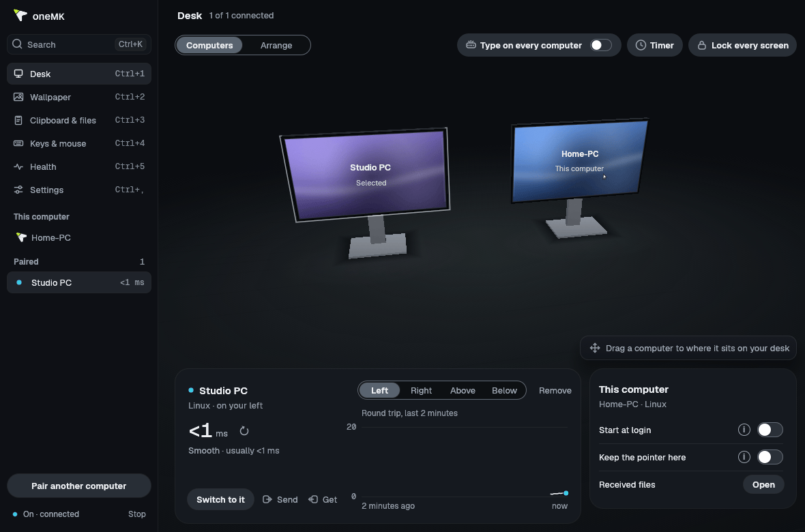
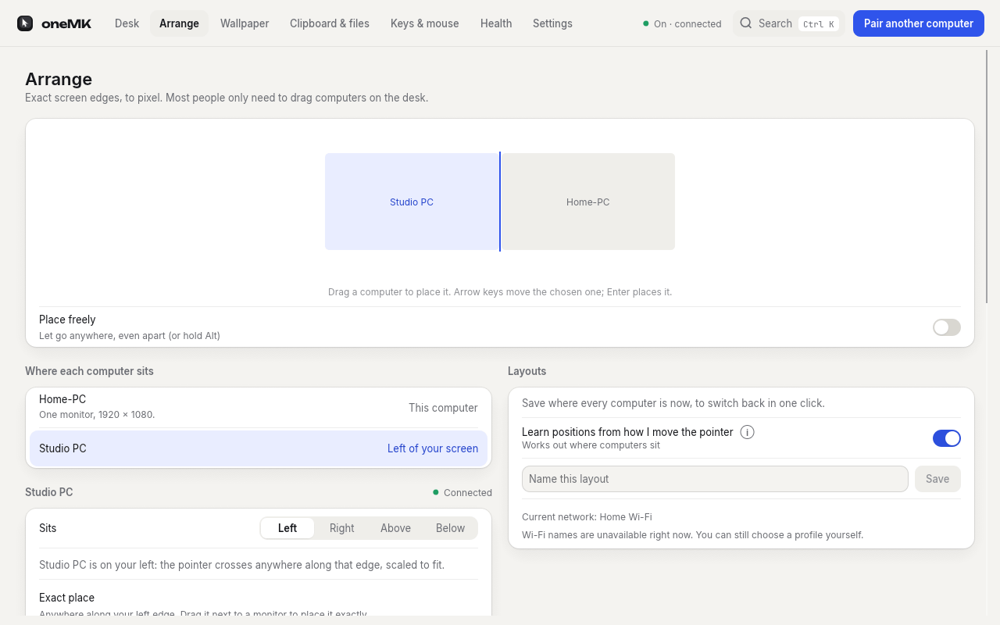
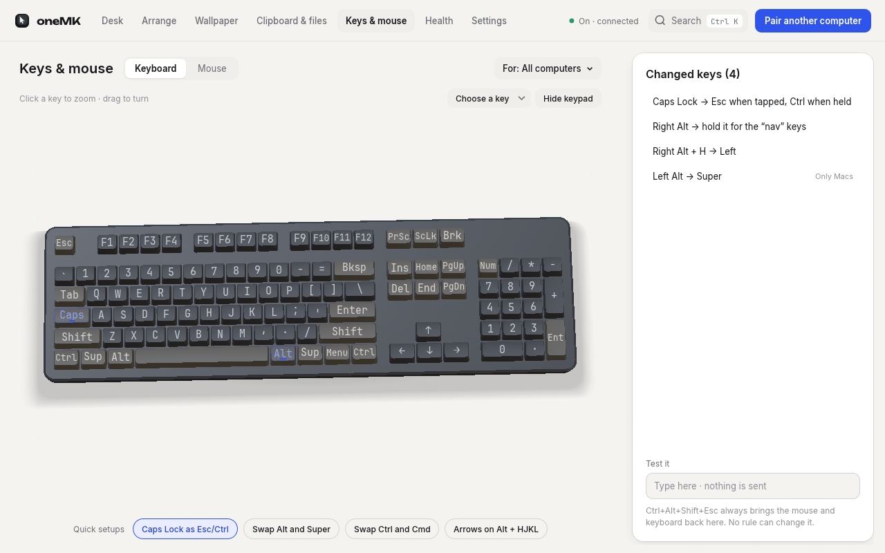

<picture>
  <source media="(prefers-color-scheme: dark)" srcset="docs/brand/logo/onemk-symbol-flat-on-dark.svg">
  
</picture>

# oneMK

**One mouse and keyboard for all your computers.** Push the pointer off the edge of one screen and it
appears on the next computer, with your keyboard, your clipboard and your files following it. Linux,
Windows and macOS; no server, no IP addresses, no certificates to copy. Pairing takes about a minute.



> **Honest status.** oneMK is young. It has been verified end to end on real hardware on **Linux with
> GNOME on Wayland** only. The Windows, macOS, KDE, X11 and wlroots backends are built and
> unit-tested on every change but have **not yet been run on real machines of those kinds**: expect
> rough edges, and please [report what you find](docs/TESTING.md). Every page here says which parts are
> experimental. See [Platform support](#platform-support).

## Why oneMK

- **Faster.** Every mouse report is forwarded at the mouse's own rate, as QUIC datagrams carrying
  absolute positions: a lost packet is replaced by the next one, so nothing is retransmitted and nothing
  waits. Clicks carry the position they were made at, and acceleration is applied once, so the pointer
  moves the same on every screen. `one-mk bench` and the window's live graph measure it ([how](docs/PERFORMANCE.md)).
- **Lighter.** The service has no polling loop and idles at about zero CPU with no peers (a connected
  peer costs about 4 to 5 timer wake-ups a second for keep-alive) and about 20 MB of memory. The window
  and the tray icon are optional and cost nothing when closed.
- **Easier.** No server and client roles, no IP addresses (computers find each other on the network),
  no certificates to copy, no root and no udev rules on Linux. Install, open the window on both
  computers, compare six digits, drag a computer to where it sits on your desk.
- **Safe by design.** Mutual TLS 1.3 pinned by a numeric pairing code, stuck keys released on every
  hand-back, an emergency chord (`Ctrl+Alt+Shift+Esc`) that cannot be remapped, signed updates
  ([security model](docs/SECURITY-MODEL.md)).

## Platform support

| Level | Systems | What that means |
|---|---|---|
| **Verified end to end on real hardware** | Linux, **GNOME on Wayland** (GNOME 45 or later needed; tried on GNOME 50) | Pairing, crossing edges, keyboard and mouse, clipboard, files and the window were used on a real desktop. Features whose page says "experimental" or "untested" (for example broadcast, pointer wrap and layout learning, video wallpaper on GNOME) were not. |
| **Experimental** (built and unit-tested, not verified on hardware) | Linux **KDE Plasma 6.1+** (same portal code as GNOME), Linux **wlroots** compositors (Sway, Hyprland, labwc, river, Wayfire), Linux **X11** desktops (tested against a virtual X server with two real daemons), **Windows 10 and 11**, **macOS** | Expect rough edges. Everything marked experimental in the docs and in the window falls in here, and so does anything below that is "new" on those systems. |
| **Not available** | Windows lock screen, sign-in screen and UAC prompts (there is no Windows service) · file edge drops on Wayland (use `one-mk send`) · per-device keyboard and mouse rules on GNOME, KDE and wlroots Wayland · taking a computer back by using its own mouse on Wayland (use `one-mk takeback`, a shortcut) · letters typing toward Linux computers · acceleration off or curves · picture wallpapers on non-GNOME Linux desktops · Windows desktop notifications | Each is refused or hidden with an explanation instead of pretending. |

Which backend runs on Linux is chosen for you: the desktop portals on GNOME and KDE Wayland, the wlroots
protocols on wlroots compositors, X11 in an X11 session (`one-mk run --backend wlroots|x11` forces one).
Details per system, the permissions each needs and what the desktops can and cannot do:
[PERMISSION-GUIDE.md](docs/PERMISSION-GUIDE.md), [WINDOWS.md](docs/WINDOWS.md), [INPUT.md](docs/INPUT.md).

## Quick start

Get the file for your system from the [latest release](https://github.com/samer2373/one-mk/releases/latest):

| System | File | Then |
|---|---|---|
| Debian, Ubuntu and relatives | `one-mk-x86_64-unknown-linux-gnu.deb` | `sudo apt install ./one-mk-x86_64-unknown-linux-gnu.deb`, then open **oneMK** from the apps menu: the first launch sets up start at login |
| Any Linux | `one-mk-x86_64-unknown-linux-gnu.AppImage` | `chmod +x` it and run it; with no arguments it opens the window, otherwise it is `one-mk` |
| macOS (Apple silicon or Intel) | `one-mk-aarch64-apple-darwin.dmg` / `one-mk-x86_64-apple-darwin.dmg` | Open it, drag oneMK onto Applications, open it; the window guides you through Accessibility permission (**experimental**) |
| Windows 10/11, 64-bit | `one-mk-x86_64-pc-windows-msvc-setup.exe` | Installs for your account alone. The installer is not code-signed yet, so SmartScreen warns (**experimental**) |
| Other Linux, by hand | `one-mk-x86_64-unknown-linux-gnu.tar.gz` | Just the programs |

On Linux and macOS one line picks the right file, checks it against the release's checksums and its
signed file list, and installs it (re-running it upgrades in place):

```bash
curl -fsSL https://raw.githubusercontent.com/samer2373/one-mk/main/install.sh | sh
```

Then, on **each** computer, open oneMK. The first time it opens it sets itself up (starts at login, adds
**Send to** to the file manager) and tells you what it did. On GNOME and KDE Wayland the desktop asks
once for permission to share input; on macOS, switch oneMK on under Privacy & Security > Accessibility
when the window asks.

1. On both computers choose **Pair another computer** (or run `one-mk pair` in a terminal on each).
2. Check that both show the **same six digits** and confirm on both.
3. Drag the other computer in the window to the side of your desk it really sits on (or
   `one-mk layout "other-pc" left`).
4. Move the pointer off the screen edge toward it. That is all. (No terminal ever needed.)

To pair without sitting at both computers, use `one-mk invite` and `one-mk join`
([details](docs/PAIRING-INVITE.md)). Something not connecting? `one-mk doctor` or the **Health** tab says
why and how to fix it ([troubleshooting](docs/TROUBLESHOOTING.md)).

## Everyday use

| Command | What it does |
|---|---|
| `one-mk status` | Is it running? Who is paired, online (with `rtt 4 ms`), and who controls whom |
| `one-mk switch <pc\|here\|next>` | Move the mouse and keyboard to a computer without crossing an edge |
| `one-mk send <files> [--to PC]` | Send files; they arrive in `Downloads/one-mk` |
| `one-mk clip-send` / `clip-get` | Send or fetch a clipboard now |
| `one-mk layout <pc> <side> [--offset DX,DY]` | Say where a paired computer sits |
| `one-mk takeback` | Take this computer back from the one controlling it |
| `one-mk stop` | Stop sharing (closing the window does not) |
| `one-mk doctor` | Find out why computers aren't connecting, with a fix for each problem |

Keyboard shortcuts, which work wherever the pointer is: `Ctrl+Alt+1` to `9` jump to computer 1 to 9,
`Ctrl+Alt+PageDown` the next one, `Ctrl+Alt+H` back here, `Ctrl+Alt+P` lock the pointer here,
`Ctrl+Alt+B` type on every computer; on Windows add Shift to the jump and broadcast shortcuts. **Emergency:
`Ctrl+Alt+Shift+Esc` always brings the pointer back to the computer you are sitting at.** Every
command and its options is in the [command reference](docs/COMMANDS.md); the same commands run behind every
button in the window.

## The window

`one-mk-app` shows your computers standing on a 3D desk, as they are arranged, with frosted glass panels
over it. Drag a computer to where it sits; watch the pointer cross the desk when you move to another
computer; click a computer to see a live round-trip graph; drop files on a computer to send them. It is
optional (it only talks to the running `one-mk`), and closing it changes nothing. Tabs: **Desk**
(Computers and Arrange), **Wallpaper**, **Clipboard & files**, **Keys & mouse**, **Health** and
**Settings**; `Ctrl+K` opens a command palette. More in [WINDOW.md](docs/WINDOW.md).

| Arrange: monitors as a wall | Keys & mouse: a 3D keyboard and mouse |
|---|---|
|  |  |

The 3D keyboard and mouse turn when you drag them and zoom in with a gliding camera when you tap a key
or a button; changed keys are marked on the drawing. The window draws the 3D scene on your graphics
card, so it uses more memory (about 125 MB) than the service (about 20 MB); close it and that is freed.

## Features

- **Arrange computers like monitors.** Each computer sits on a side of yours, anywhere along it or at an
  exact pixel offset with several monitors, with named layout profiles that can switch by Wi-Fi network
  or subnet. [ARRANGING.md](docs/ARRANGING.md), [WIFI-PROFILES.md](docs/WIFI-PROFILES.md).
- **Pairing.** A numeric code compared on both screens, or an expiring one-time invitation link, with a
  sensible side chosen for you and kept in sync on both computers.
  [PAIRING-INVITE.md](docs/PAIRING-INVITE.md), [PAIRING-LAYOUT.md](docs/PAIRING-LAYOUT.md).
- **Clipboard.** Text, rich text and images follow the pointer, or move on demand
  (`clip-send`, `clip-get`, a fetch shortcut). Password-manager copies stay put; history is off by
  default. [CLIPBOARD.md](docs/CLIPBOARD.md).
- **Files.** `one-mk send`, drag onto a computer in the window, or **Send to** in the file manager:
  resumable, checked with BLAKE3, with progress and an arrival notice.
  [FILES.md](docs/FILES.md). Dropping files on a screen edge exists but is opt-in and experimental
  ([DRAG-FILES.md](docs/DRAG-FILES.md)).
- **Keys and mouse rules.** Remap keys, combos, tap and hold, layers, actions and sequences; map mouse
  buttons; pointer speed; scrolling direction, speed and modifiers; per computer, per OS, per app or per
  device; autoscroll and gestures (opt-in). Typing the letters printed on your keys (**Letters** and
  **Auto**) and rules for your own keyboard are experimental. [INPUT.md](docs/INPUT.md).
- **Switching and edge rules.** Shortcuts, `switch`, lock the pointer to one computer, gaming mode (raw
  movement), dead corners, dwell, a key to hold, a fullscreen guard, pointer wrap and layout learning
  on edges where nothing sits. [ARRANGING.md](docs/ARRANGING.md), [EDGE-PUSH.md](docs/EDGE-PUSH.md).
- **Broadcast.** Type, click and scroll on every connected computer at once.
  [BROADCAST.md](docs/BROADCAST.md).
- **Automation.** Run a command when the pointer arrives or leaves or a computer connects; keep
  controlled computers awake and sleep displays together; lock every screen at once; media keys cross
  like any key. [AUTOMATION.md](docs/AUTOMATION.md).
- **Mac and PC keyboards.** Ctrl and Cmd trade places between a Mac and a PC by default, per computer
  ([INPUT.md](docs/INPUT.md#mac-and-pc-keyboards-ctrl-and-cmd)).
- **Live wallpaper (experimental outside Linux X11).** One video or picture across all your screens and
  computers as one continuous canvas; your own wallpaper comes back when you turn it off or uninstall.
  Works through a GNOME extension on GNOME 50 Wayland and layer-shell on other Wayland desktops.
  [LIVE-WALLPAPER.md](docs/LIVE-WALLPAPER.md).
- **Pointer on a computer with no mouse**, and an optional GNOME extension that hides the local pointer
  while the mouse is away. [NO-MOUSE-POINTER.md](docs/NO-MOUSE-POINTER.md),
  [POINTER-HIDE.md](docs/POINTER-HIDE.md).
- **Health, updates, tray.** `one-mk doctor` and the **Health** tab name real problems and their fixes.
  Signed updates are on, checked daily, never installed in the background without asking
  ([UPDATES.md](docs/UPDATES.md)). The tray icon gives the main actions without the window
  ([WINDOW.md](docs/WINDOW.md#tray-icon-optional)).

## Troubleshooting

Start with `one-mk doctor` (it only reads, never changes your firewall or settings). The usual causes:
different networks or client isolation, the firewall (allow **UDP 24900**, and mDNS on 5353), or a
desktop permission still waiting for you. If a pointer or key ever seems stuck, press
`Ctrl+Alt+Shift+Esc`. The full list of symptoms and fixes is in
[docs/TROUBLESHOOTING.md](docs/TROUBLESHOOTING.md). To report a bug, attach the output of `one-mk doctor`
from each computer ([CONTRIBUTING.md](CONTRIBUTING.md)).

## Security

Computers talk over mutual TLS 1.3 on QUIC, pinned by certificate fingerprint at pairing with a
commit-then-reveal numeric code that defeats man-in-the-middle attacks; only paired computers can connect.
Received files cannot escape the download folder or overwrite anything. Keys and settings are private to
your account, hooks run only from a settings file nobody else can write, and updates are accepted only if
they verify against a key built into oneMK. Details, limits and what is not protected:
[docs/SECURITY-MODEL.md](docs/SECURITY-MODEL.md). To report a vulnerability, see
[SECURITY.md](SECURITY.md).

## Uninstall

1. `one-mk uninstall` removes start at login and the file manager entries, turns the wallpaper off (your
   own comes back) and removes oneMK's GNOME extension. Run it before removing the program.
2. Remove the program: `sudo apt remove one-mk` (`apt purge` also deletes its one system-wide record, `/var/lib/one-mk`);
   delete the AppImage or `~/.local/bin/one-mk*` for the other Linux installs; drag oneMK from
   Applications to the Trash on a Mac; use **Apps > Installed apps** on Windows.
3. To forget everything, delete the settings folder (`~/.config/one-mk` on Linux). It holds this
   computer's identity and its pairings.

## Building from source

You need a stable Rust toolchain (and on Linux the usual development libraries; see
[CONTRIBUTING.md](CONTRIBUTING.md)).

```bash
cargo build --locked -p one-mk -p one-mk-tray -p one-mk-app -p one-mk-wallpaper-helper   # debug build
cargo test --locked --workspace
# release build (fat LTO needs a lot of memory; -j 2 is gentle):
cargo build --release --locked -j 2 -p one-mk -p one-mk-tray -p one-mk-app -p one-mk-wallpaper-helper
```

The programs: `one-mk` (service and command line), `one-mk-app` (window), `one-mk-tray` (tray icon) and
`one-mk-wallpaper` (the wallpaper player, built by `one-mk-wallpaper-helper`). They belong in one folder.
How each package is made and which are untested: [docs/PACKAGING.md](docs/PACKAGING.md).

## Documentation

[Command reference](docs/COMMANDS.md) · [Arranging](docs/ARRANGING.md) · [Input](docs/INPUT.md) ·
[Clipboard](docs/CLIPBOARD.md) · [Files](docs/FILES.md) · [Automation](docs/AUTOMATION.md) ·
[Window and tray](docs/WINDOW.md) · [Live wallpaper](docs/LIVE-WALLPAPER.md) ·
[Troubleshooting](docs/TROUBLESHOOTING.md) · [Security model](docs/SECURITY-MODEL.md) ·
[Updates](docs/UPDATES.md) · [Packaging](docs/PACKAGING.md) · [Testing on real hardware](docs/TESTING.md) ·
[Windows](docs/WINDOWS.md) · [macOS permissions](docs/PERMISSION-GUIDE.md) ·
[Release notes](docs/release-notes/).

## Contributing and licence

Bug reports, tests on real Windows, macOS, KDE and wlroots machines and focused pull requests are welcome:
see [CONTRIBUTING.md](CONTRIBUTING.md) and the [issue forms](https://github.com/samer2373/one-mk/issues/new/choose).

oneMK is licensed under either of [Apache-2.0](LICENSE-APACHE) or [MIT](LICENSE-MIT), at your option.
Unless you say otherwise, any contribution you submit is licensed the same way, with no extra terms.
Third-party licences are in [THIRD-PARTY-NOTICES](THIRD-PARTY-NOTICES). The 3D mouse model is
"Logitech G502 X Lightspeed" by Okopchi, [CC BY 4.0](https://sketchfab.com/3d-models/logitech-g502-x-lightspeed-cda7107cc1444b4788d747f0361f7d40).
