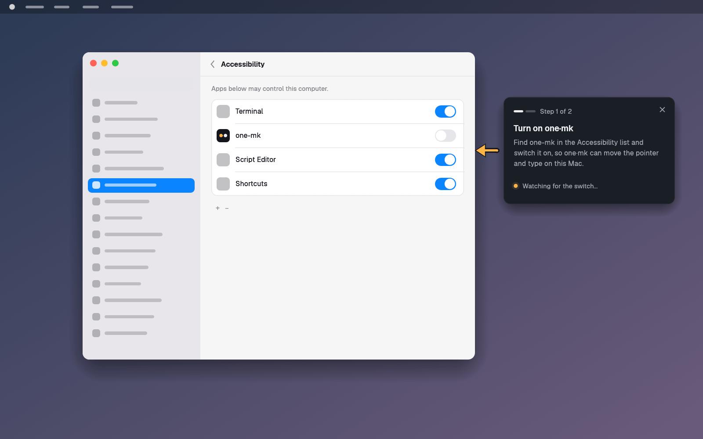
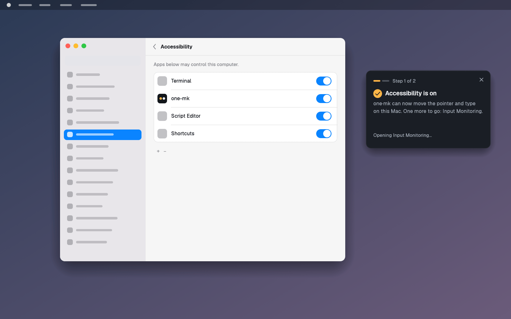
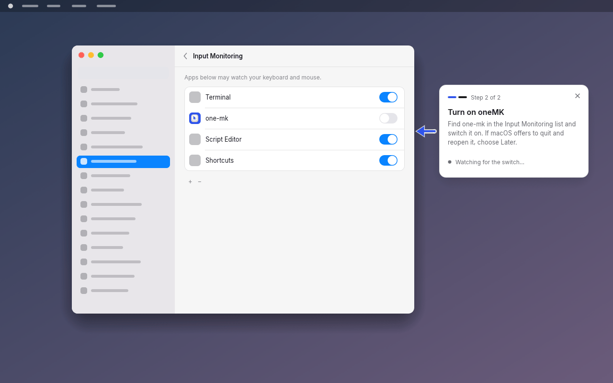
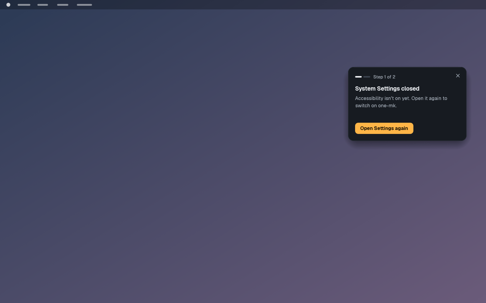
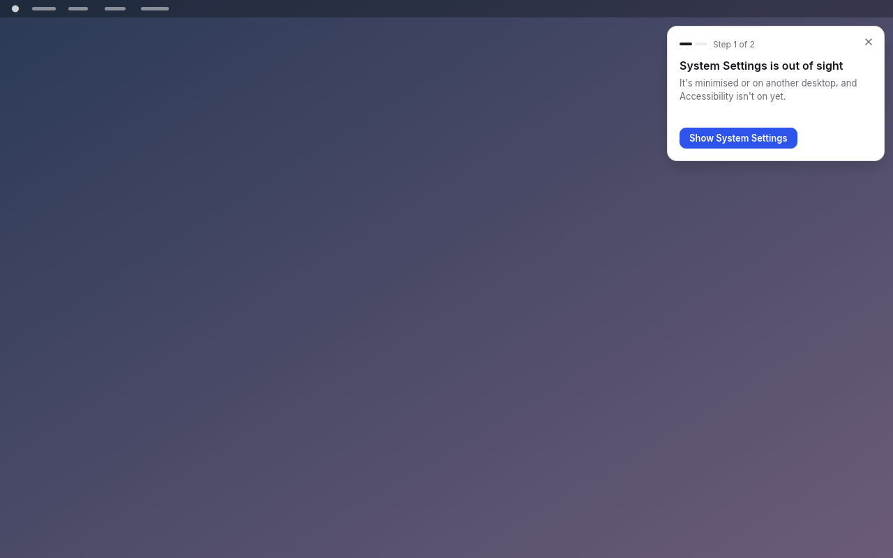
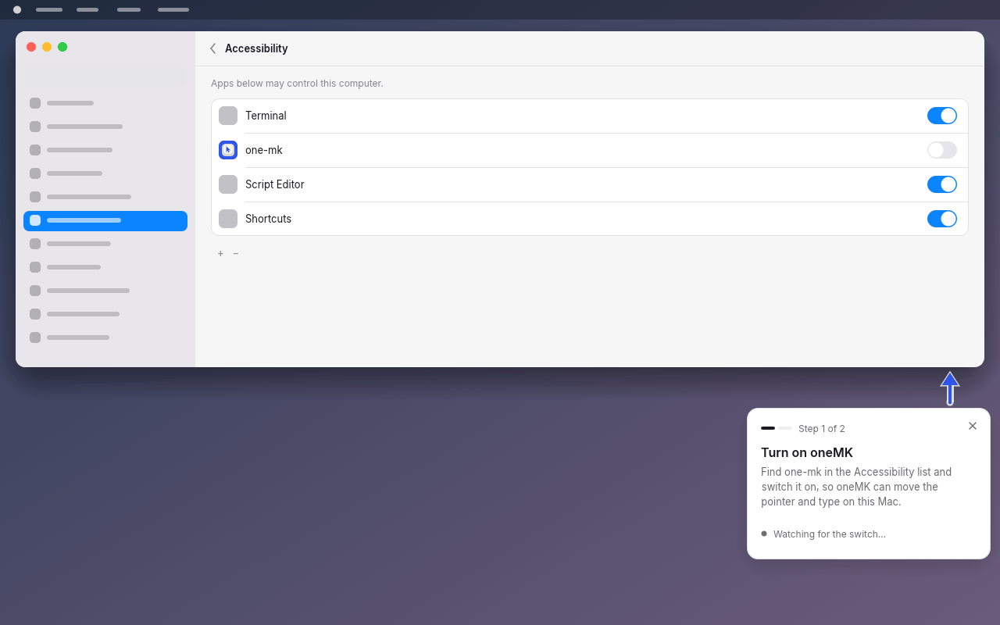
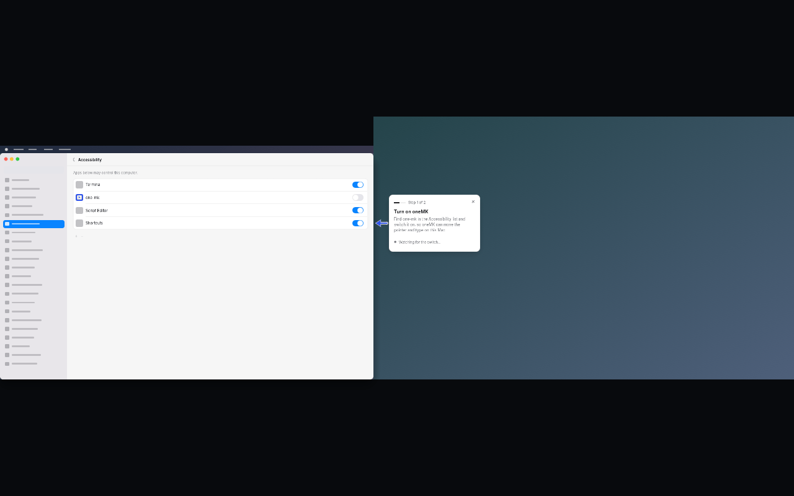

# Permission guide (macOS)

When one·mk needs a macOS permission (Accessibility, then Input
Monitoring), the window opens the matching System Settings pane and a small
card floats **next to the System Settings window**: an arrow points at the
list where the switch is, one line says what to do, a step indicator says
where you are (1 of 2, 2 of 2). It follows System Settings when it moves and
watches the permission: when the switch goes on the card ticks, moves on to
the next permission or leaves, and brings one·mk back to the front. If System
Settings is closed first, the card says so and offers **Open Settings
again**.

> **Status.** The layout, the state machine and the drawing are built and
> tested on Linux. Everything that talks to macOS (finding the System
> Settings window, floating above it, following it, where the arrow points,
> activation) is **compile-checked for `aarch64-apple-darwin` and
> `x86_64-apple-darwin` only and has never run on a Mac.** Use the manual
> test script below before shipping it. The guide is wired: on a Mac the
> window opens it by itself when the daemon reports a missing permission
> (see [Integration](#integration)).



| | |
|---|---|
|  |  |
|  |  |
|  |  |

The screenshots are drawn on a **pretend desktop** (the debug-only stage,
see [Development aids](#development-aids)): the System Settings in them is a
drawing, not a capture, and the `one-mk` row is placed where the arrow
points. On a real Mac the row's position is not known (see Limits).

## Files

| File | What |
|---|---|
| `crates/ctl/src/macos_windows.rs` | macOS: where the System Settings window is (`settings_window()`), the screens' usable areas (`screens()`), `open_pane(Pane)`, `bring_to_front()`. Other systems: stubs (no window, no screens). Pure, tested helpers `pick_settings_window`, `settings_state`. |
| `crates/app/src/guide.rs` | `place_card` (layout, pure), `Guide` (state machine, pure), `Overlay` (polling, effects, drawing in its own viewport), debug aids and the stage. |
| `crates/app/src/main.rs` | one line: the main window asks for a GL config with alpha (`guide::needs_transparent_root()`), see Limits. |
| `crates/app/src/app.rs` | three lines: the `guide` field, `Overlay::from_env()`, `self.guide.show(ctx)` each frame. |
| `scripts/guide-shots.sh` | makes `docs/screens/guide-*.png`. |

## Behaviour

### States

| Phase | Card says | Footer | Arrow |
|---|---|---|---|
| **Waiting** | *Turn on one·mk*: find `one-mk` in the *Accessibility* list and switch it on (for Input Monitoring: and choose *Later* if macOS offers to quit and reopen it, the advice the daemon already gives) | amber dot, *Watching for the switch…* (*Waiting for System Settings…* while it isn't on screen) | points at the window, nudges three times every ~5 s |
| **Granted** (1.2 s) | ✓ *Accessibility is on*: what it lets one·mk do; what comes next | *Opening Input Monitoring…* / *Taking you back to one·mk…* | fades out |
| **Settings closed** | *System Settings closed*: Accessibility isn't on yet | **Open Settings again** | none |
| **Settings out of sight** | *System Settings is out of sight*: minimised or on another desktop | **Show System Settings** | none |
| **Done** | (the last words stay while it fades out, 0.32 s) | | |

- The header shows the steps as bars (done: amber, current: white, to do:
  grey) and *Step 1 of 2*; with one step it says *one·mk setup*. A
  permission that is already on when the guide starts is skipped, so a Mac
  that only needs Input Monitoring starts at *Step 2 of 2* with step one
  shown done.
- **Grant order doesn't matter.** A later permission granted early is
  skipped when its turn comes. A grant while Settings is closed still ticks
  and moves on.
- **Revoked**: switched off during the tick → back to waiting; an earlier
  step switched off later → back to that step (its pane reopens); switched
  off while the card is leaving → back to it. Once the guide has closed, a
  revoke is not its business: start it again.
- **Settings vanishing**: 1.5 s of grace (switching panes or Spaces) before
  *closed*; after asking for a pane, 8 s for Settings to launch. Closed vs.
  out of sight: System Settings not running vs. running with no window on
  this Space. *Open Settings again* re-opens the pane (which also brings
  the window to this Space).
- **Covered**: when another app's window covers more than half of System
  Settings (you went to do something else), the card fades away and comes
  back when Settings is in front again. No "closed" message for that.
- **The close button** (×) ends the guide without bringing one·mk forward.
- When everything is on, one·mk's window is brought to the front (macOS
  `activateWithOptions` plus egui's focus command).

### Where the card goes (`place_card`)

1. Right of the Settings window (the switches are at the right end of each
   row), else left, else below, else above, on the screen holding the
   window's middle; then right or left on another screen; else a corner
   with no arrow (top right with no window to point at, bottom right when
   Settings fills the screen).
2. The card is never off a screen's usable area (menu bar and Dock
   excluded, 12 pt margin). A card bigger than the screen shows its start
   (top-left).
3. The arrow's tip stays 8 pt outside the window, inside the window's span
   and on screen; vertically it aims at `switch_spot()`: about a third of
   the way down (110–240 pt below the window's top), where the app list
   starts. Below/above: horizontally at the switch column (44 pt from the
   right edge).
4. It follows the window: polled 30 times a second for a second after it
   moved, else 4 times a second, with a 0.16 s glide; changing sides snaps
   (gliding across Settings would cover it).

### Motion

Entrance: fade and a 10 pt slide from the side away from the window.
Tick: the circle pops (`back_out`), the tick draws in. Exit: fade and
slide. Arrow: three quick nudges towards the window, then a 1.8 s rest
(the window idles at 4 polls a second while it rests).

**Reduced motion** (`motion::reduced()`, i.e. `ONE_MK_REDUCE_MOTION=1` or
macOS's *Reduce motion*): no slides, no glide (the card snaps), no pop, no
draw-in, no nudge, no beating dot; only short fades remain. Compare
`guide-01-beside-window.png` (arrow mid-nudge) and
`guide-09-reduced-motion.png` (still).

### Accessibility

The title is an accesskit heading in a polite live region (state changes are
announced), the body a label; the buttons are real buttons with names
("Close this guide", "Open Settings again"). The card window never takes
focus when it appears (`with_active(false)`).

## Integration

**Wired.** The macOS backend now sends its missing-permission message as a
status line (`Event::Status { part: "permission" }`, cleared when granted),
so it is in `status.input`. `App` calls `Overlay::on_status` for every
status; it opens the guide once per gap on macOS (closing it is respected
until a status shows everything granted, then a later revoke opens it
again) and keeps it in step while open. What follows is the reference
for how that works and what is still open (items 4 and 5).

1. **Start it**, on macOS only, when the daemon reports a missing
   permission, preferably from a button the person pressed (it opens
   System Settings):

   ```rust
   let lines = status.input.clone();
   app.guide.start(
       &[Permission::Accessibility, Permission::InputMonitoring],
       Box::new(guide::StatusPermissions { lines }),
       now,
   );
   ```

   Pass both steps: the daemon only checks Input Monitoring once
   Accessibility is on, so whether it is needed is unknown at the start;
   if it turns out to be on, step two is skipped.
2. **Feed it every new status** while it runs:
   `app.guide.set_status_input(&status.input, now)` (or
   `set_granted(p, bool, now)` from your own source, or implement
   `PermissionSource` in `crates/ctl/src/setup.rs` and pass that to
   `start`). Don't feed it when there is no status (daemon not running):
   no "missing" line reads as "everything is on".
3. `Permission::missing_from_status` matches the start of the daemon's
   messages in `crates/input/src/macos.rs` (`Problem::message`: *"one-mk
   needs Accessibility permission"*, *"one-mk needs Input Monitoring
   permission"*). If those change, change it; a structured status field
   would be sturdier.
4. **Who opens System Settings.** The guide opens the pane itself
   (`Effect::OpenPane`). The daemon also opens it, once, the first time it
   finds a permission missing. Opening the same URL twice is harmless (it
   focuses the window), but decide who owns it.
5. **The list entry must exist.** The switch only appears in the list after
   the program that needs the permission asks for it (the daemon calls
   `AXIsProcessTrustedWithOptions(prompt)` and
   `CGRequestListenEventAccess`). The app can't do that for the daemon
   (permissions belong to the executable that asks). The daemon asks once
   per run (`asked_accessibility`, `asked_input_monitoring`); if someone
   removed the entry with "−", nothing re-adds it until the daemon
   restarts. The setup core should be able to tell the daemon to ask again
   when the guide starts.
6. `app.guide.active()` tells whether the card is up; `stop()` drops it.

## Limits and what is unverified

Unverified on a Mac (compile-checked only):

- **Finding the window.** `CGWindowListCopyWindowInfo(on screen only,
  excluding desktop elements)`, owner process = a running
  `com.apple.systempreferences` (via `NSRunningApplication`; falls back to
  the owner names "System Settings"/"System Preferences"), layer 0, alpha >
  0, both sides ≥ 120 pt, the largest. Reading other apps' window
  **bounds and owner** needs no permission; only window *titles* need
  Screen Recording, and they aren't used. Worth confirming on macOS 13, 14
  and 15.
- **Coordinates.** CoreGraphics bounds and winit positions are both taken
  to be points with the origin at the top-left of the main display; screens
  come from `NSScreen.visibleFrame`, flipped from Cocoa's bottom-left
  origin. Mixed-scale monitors (a Retina laptop beside a 1x display) may be
  off by the scale ratio while the card crosses between them, because egui
  converts positions with the card window's own scale.
- **Always on top over System Settings.** The card uses winit's
  `AlwaysOnTop` (NSFloatingWindowLevel). Floating windows stay above other
  apps' normal windows even when one·mk isn't active, but the card exists
  on one Space only: if System Settings is on another Space or full screen,
  the card is not there (it says *out of sight* after the grace).
- **Clicking the card activates one·mk.** winit has no non-activating
  panel, so clicking the card (× or the button) makes one·mk the active app
  and may bring its main window above System Settings. *Open Settings
  again* immediately re-activates Settings; × ends the guide anyway.
- **Bringing one·mk back.** From macOS 14 app activation is cooperative:
  `activateWithOptions` from a background app may be refused while System
  Settings is frontmost. Then the window stays behind (the dock icon may
  bounce).
- **Transparency.** On macOS the main window is now created with
  `transparent(true)` (so the GL config has alpha for the card's window;
  eframe's glow backend picks one config for every window). The main
  window still paints itself fully opaque. On Linux this was verified under
  XWayland: the card's window gets a 32-bit visual with fully transparent
  corners; without the flag they were black. Not seen on a Mac.
- **Where the arrow points.** `switch_spot()` is an estimate of where the
  app list starts in the pane (a third of the way down, 110–240 pt); the
  arrow is level with the list, not with one·mk's row: the row's position
  depends on the other apps listed, the window size and macOS version, and
  reading it would need Accessibility access to System Settings (exactly
  what is not granted yet). Adjust `switch_spot()` after seeing it.
- **Covered detection** uses the window list's front-to-back order;
  Stage Manager's side strip and other unusual layouts are untested.

TCC notes I am not sure of:

- **Which entry appears.** The daemon (`Contents/MacOS/one-mk`) is the
  program that needs both permissions; the window (`one-mk-app`) and the
  menu bar icon don't. Launched by launchd from inside the bundle, the
  daemon may be listed under its own executable name **`one-mk`** (with a
  generic icon) rather than as *one·mk* with the app icon, and the window
  may be listed separately if it ever asked. The card therefore says
  *Find one-mk in the … list* (`LIST_NAME`). If a Mac shows *one·mk*,
  change `LIST_NAME`.
- **Code signature.** TCC records the code signature; a release with a
  different signing identity (ad-hoc builds sign differently each time) may
  show a stale entry that is on but doesn't apply. The guide then waits
  forever with the switch visibly on. Turning it off and on, or removing
  the entry, fixes it; the card doesn't say so yet.
- **Started from a terminal** (`one-mk run`), the permission belongs to the
  terminal app, not to `one-mk`; the daemon's message says so, the card
  doesn't. The guide is meant for the installed app.
- **Input Monitoring's "Quit & Reopen"** dialog: the card repeats the
  daemon's advice (*choose Later*); what happens to a launchd-managed
  daemon on *Quit & Reopen* has not been tried.

## Manual test script (a real Mac)

Build the app bundle as usual, install it, and have the service running
(`one-mk install`). Use a debug build of `one-mk-app` for steps 1–9 (the
`ONE_MK_APP_GUIDE` aid); the permission state is faked by the aid but the
**window finding, placement and floating are real** when
`ONE_MK_GUIDE_FAKE_RECT` is not set.

1. `ONE_MK_APP_GUIDE=both ONE_MK_GUIDE_FAKE_GRANT=6 target/debug/one-mk-app`.
   System Settings opens on Privacy & Security › Accessibility. **Check:**
   the card appears to the right of the Settings window, not on top of it;
   no title bar, rounded corners with a soft shadow, **no black corners**;
   the arrow's tip just outside Settings' right edge; it does not steal the
   keyboard (typing in Settings' search field still works).
2. **Check the arrow's height** against the list of apps. Note the offset
   from the first row and from the `one-mk` row; adjust `switch_spot()`.
3. Drag System Settings around slowly and fast. **Check:** the card
   follows without lag over ~0.2 s, never covers Settings, switches to the
   left side when Settings is near the right edge, goes below when Settings
   is very wide.
4. With a second monitor: drag Settings to it, and to straddle both.
   **Check:** the card is on the screen holding Settings' middle, inside the
   usable area (not under the menu bar or Dock), at the right position (not
   scaled wrongly on a mixed-DPI pair).
5. After 6 s step one ticks, then System Settings switches to Input
   Monitoring and the card says *Step 2 of 2*; 6 s later it ticks and the
   card fades out. **Check:** one·mk's window comes to the front (on macOS
   14+: note whether it does or only bounces).
6. Run again; close System Settings (red button or ⌘Q). **Check:** after
   about 1.5 s *System Settings closed* with **Open Settings again**;
   clicking it reopens the pane and the card points at it again. Note
   whether clicking the card brought one·mk's main window over Settings.
7. Run again; minimise System Settings (⌘M), then repeat with it moved to
   another Space. **Check:** *System Settings is out of sight*; **Show
   System Settings** brings it back.
8. Run again; bring a large window of another app (e.g. a maximised Finder
   window) over System Settings.
   **Check:** the card fades away; clicking Settings brings it back.
9. Turn on *Reduce motion* (Accessibility › Display) and run again.
   **Check:** no sliding, no nudging arrow, the tick appears without the
   pop.
10. The real thing (once integrated): remove `one-mk` from both lists
    (select, "−"), restart the service (`one-mk install` or log out and in),
    open one·mk and start the guide. **Check:** which name and icon the
    entry has in each list (`one-mk`? `one·mk`? both the app and the
    daemon?), that switching it on ticks the card within about a second,
    and that turning Accessibility off again afterwards brings the guide
    back to step one if it is still open.

Record macOS version, Mac model, monitor setup and screenshots of steps 1,
2, 4 and 10 in the pull request.

## Development aids

Debug builds only, like the window's other `ONE_MK_APP_*` aids:

| Variable | Effect |
|---|---|
| `ONE_MK_APP_GUIDE=accessibility\|input-monitoring\|both` | starts the guide |
| `ONE_MK_GUIDE_FAKE_RECT=x,y,w,h` | a stand-in Settings window (`hidden`, `closed`: none); unset: the real one on macOS, none elsewhere |
| `ONE_MK_GUIDE_FAKE_SCREENS=x,y,w,h;…` | the screens' usable areas (default: the real ones on macOS, one 1440×900 screen elsewhere) |
| `ONE_MK_GUIDE_FAKE_GRANT=s` | Accessibility on after *s* seconds, Input Monitoring *s* seconds after its step shows |
| `ONE_MK_GUIDE_FAKE_CLOSE=s` | the stand-in window closes after *s* seconds (the button brings it back) |
| `ONE_MK_GUIDE_FAKE_MOVE=1` | the stand-in window drifts, to watch the card follow |
| `ONE_MK_GUIDE_FAKE_COVER=a,b` | another app covers it from *a* to *b* seconds |
| `ONE_MK_GUIDE_STAGE=1\|dark` | draws a pretend desktop and System Settings (light or dark) in the main window with the card on it, for screenshots |

`scripts/guide-shots.sh [OUT_DIR]` makes the screenshots (`docs/screens`
for the committed set). Without the stage, the card's real floating window
runs on Linux too: under X11/XWayland (`env -u WAYLAND_DISPLAY`) it is
placed where `place_card` says; Wayland ignores positions.

Tests: `cargo test -p one-mk-app guide` (placement table, state machine,
card size, a headless click on *Open Settings again*) and
`cargo test -p one-mk-ctl` (window picking, covered detection).
