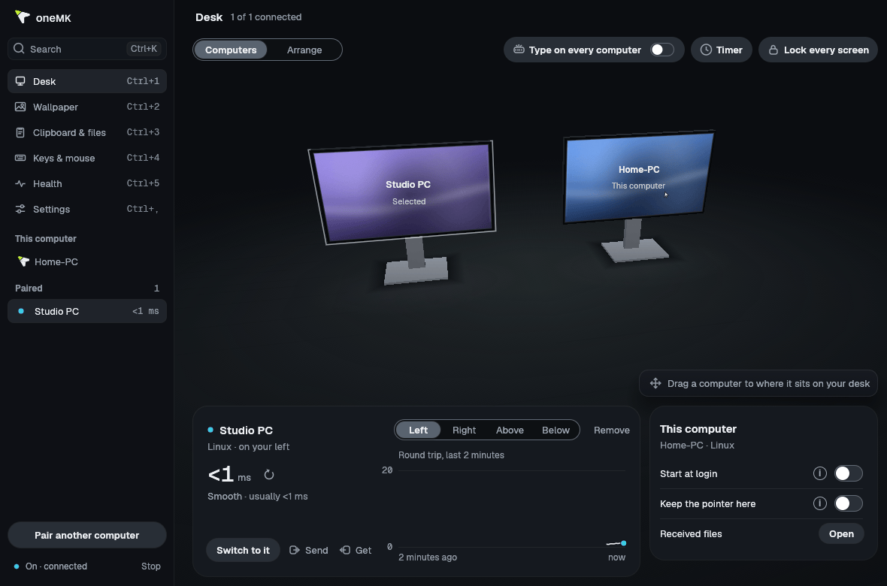
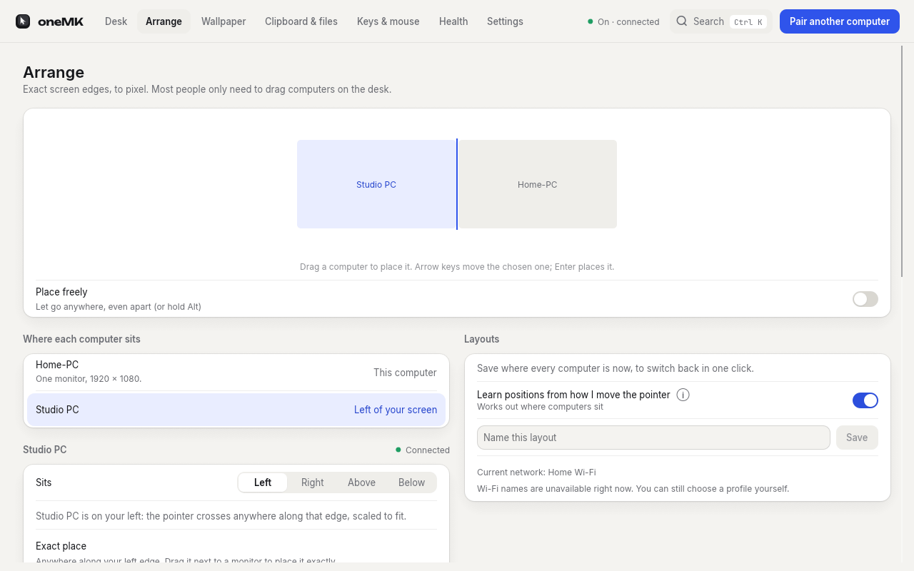
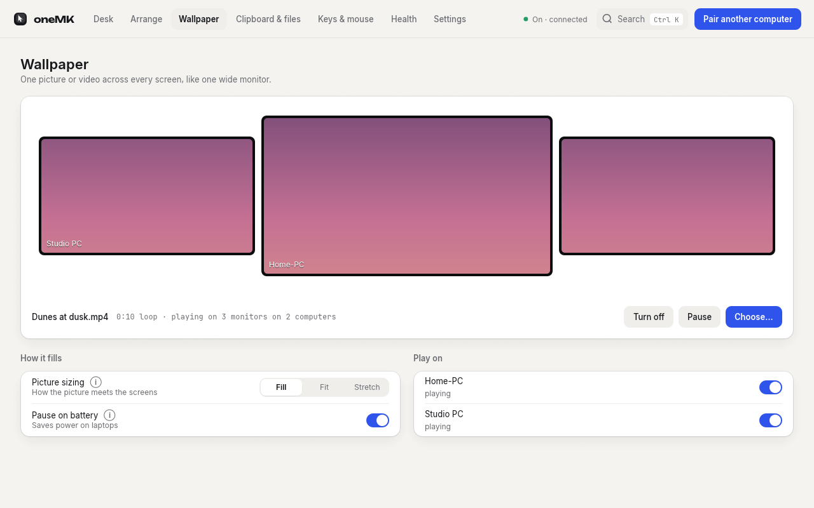
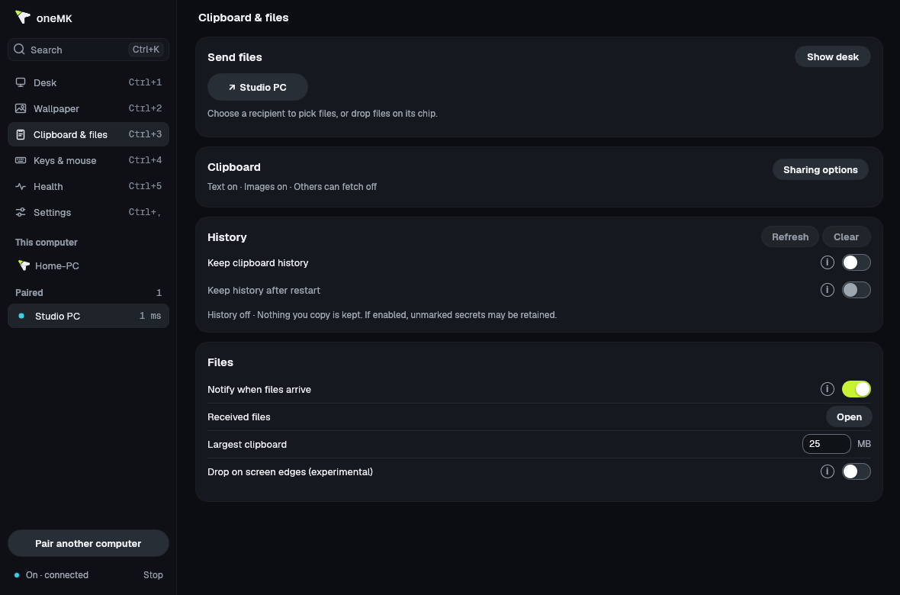
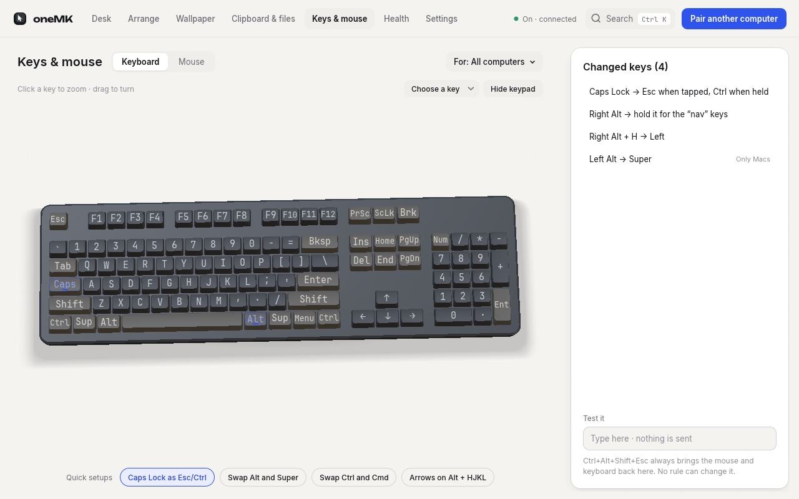
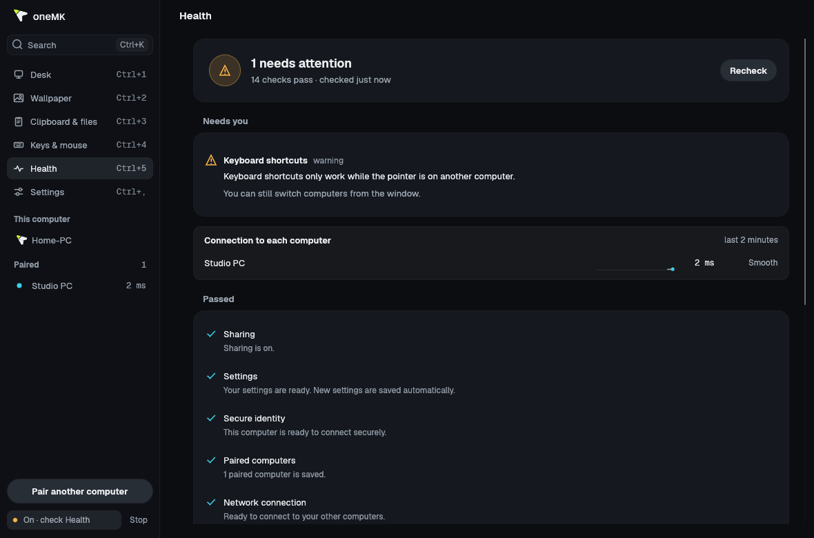
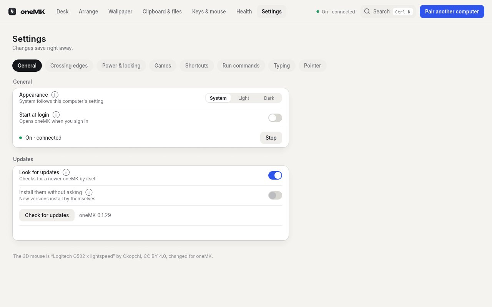

# The window and the tray icon

`one-mk-app` is the window: your computers standing on a 3D desk, as they are arranged.
Open it from the apps menu, from the tray ("Open oneMK…", or a left click on Linux), or by
running `one-mk-app`. It is optional: it only talks to the running `one-mk`, so closing it
changes nothing (closing the window does **not** stop sharing; `one-mk stop` or the
**Stop** control does), and it costs nothing when it is not open. It must sit in the same
folder as `one-mk`. The first time it opens it sets oneMK up (starts at login, adds the file
manager's "Send to" entries) and says so.

Every change goes through the same `one-mk` commands you would type, so the command line and
the window always agree. `Ctrl+K` (Cmd+K on a Mac) opens a command palette that goes to any
page or runs any action; `Ctrl+1` Desk, `Ctrl+2` Wallpaper, `Ctrl+3` Clipboard & files, `Ctrl+4` Keys & mouse, `Ctrl+5` Health
and `Ctrl+,` Settings jump to pages (the sidebar shows each page's key). The window respects the system's reduced-motion setting.

## Desk

Two views, **Computers** and **Arrange**.

- **Computers.** Drag a computer to the side it is really on (right-click it for above or
  below); the change applies at once, on both computers. Click one to measure the connection
  again, send it this clipboard, get its clipboard, **Switch to it**, keep the pointer here,
  lock every screen, or type on every computer at once. Drop files or folders onto a computer
  to send them. Pairing happens here too: the code appears on both screens of the desk and
  in a panel with **Codes match, pair** and **They don't match**.
- **Connection graph.** A small graph of the last two minutes under the selected computer
  (and one line per computer on Health) shows the time an answer takes now, the lowest,
  average and highest, and says **Smooth**, **Some stalls** (more than 1 in 20 readings over
  40 ms, or any lost packet) or **Slow** (more than 1 in 20 over 100 ms, or 8 lost packets);
  amber means it is worth a look, and the word says the same without colour. An offline
  computer says so and has no graph. The numbers come free from the connection itself: oneMK
  sends nothing extra and runs no timer for it. The window asks once a second, only while a
  graph is on screen, redraws a steady graph only when it changes, and keeps 120 readings per
  computer in memory, nothing on disk.
- **Arrange.** Every computer's real monitors as a monitor wall; drag a computer next to one
  of your monitors and it snaps there, crossing only where the screens touch (the placement
  syncs to the other computer). Choose a side to let it cross anywhere along that side again.
  Save, use and delete layout profiles, and let one switch in by itself on a Wi-Fi network.
  See [ARRANGING.md](ARRANGING.md).

## Wallpaper

Choose a video or picture, how it fills the screens, which computers show it, pause, and turn
off (your own wallpaper comes back). Labels say what is experimental on your computer. See
[LIVE-WALLPAPER.md](LIVE-WALLPAPER.md).

## Clipboard & files

What the clipboard shares and whether others may get it, the clipboard's size limit,
clipboard history (off by default, with a second click to clear), notifications, the received
files folder, the experimental edge-drop switch (hidden on Wayland, where it cannot work),
and each transfer with a progress bar. See [CLIPBOARD.md](CLIPBOARD.md) and
[FILES.md](FILES.md).

## Keys & mouse

A drawn 3D keyboard and mouse. Drag to turn them, tap to zoom in with a gliding camera. Click
a key (or move to it with the arrows and press Enter), then press the key it should become,
pick it from a searchable list, or make it do nothing; "hold for another key" is under More.
Changed keys are marked on the drawing and listed as sentences ("Caps Lock → Esc when tapped,
Ctrl when held"), with quick setups (Caps Lock as Esc/Ctrl, swap Alt and Super, swap Ctrl and
Cmd for Mac keyboards, arrow keys on Right Alt + HJKL), problems from `one-mk keymap check`,
and **For:** all computers, one OS or one computer. A **Test it** box runs your rules right
there (nothing is sent) and shows what the other computer would get, and whether a tap/hold
key counted as a tap or a hold. On the mouse side: what each button does (another button, a
key or shortcut, switching computers, locking, a media key, a command), pointer speed, and
scrolling (direction, speed, steps, natural scrolling, Shift to scroll sideways). See
[INPUT.md](INPUT.md).

## Health

The results of `one-mk doctor` (run when the page opens and on **Recheck**), each with its fix
and a button to copy the command (or, for starting and pairing, the window's own button), plus
what oneMK says right now (for example a permission still to approve) and the live connection
to each computer. See [TROUBLESHOOTING.md](TROUBLESHOOTING.md).

## Settings

Updates (daily check on or off, release notes), edge rules (corners, waiting at the edge, a key
to hold, fullscreen guard), pointer wrap and layout learning, keeping controlled computers
awake, sleep and lock sync, gaming mode, keyboard shortcuts on or off, typing mode, drawing a
pointer on a computer with no mouse, start at login, and Ctrl/Cmd swapping per computer.
Commands to run on events (hooks) are edited in `settings.toml`; see
[AUTOMATION.md](AUTOMATION.md).

## Tray icon (optional)

`one-mk-tray` is a small separate program that puts a oneMK icon in the system tray (menu bar
on macOS). oneMK works the same without it. Start it by running `one-mk-tray` (or turn on
"Start at login" in its menu). It must sit in the same folder as `one-mk`; use
`one-mk-tray --home <dir>` for a non-default settings folder. The menu shows:

- whether oneMK is running and who it is connected to ("Connected to desk (on your right)");
- each paired computer, with a submenu to move it left, right, above or below (applied at
  once, like `one-mk layout`), and **Remove**;
- a line for each file transfer that is running ("Receiving 3 files from desk: 45%");
- **Switch to <computer>** and **Send clipboard to <computer>** for each connected computer
  (**Switch back here** while another one has control);
- **Open oneMK…**, which opens the window;
- **Type on every computer** (a checkmark, while a computer is connected), and the headline
  "Broadcasting to N computers" while it is on;
- **Keep the pointer here**, **Lock every screen**, **Take back control**, **Start oneMK**
  (when it is not running), **Pair a computer…** (when none is paired) and **Start at login**;
- **Quit tray**, which closes only the tray.

The icon is the oneMK keycap with the pointer on its top, in white ink for a dark bar and black
for a light one (macOS and Windows follow the system's dark or light mode, read when the icon
changes; Linux panels cannot say, so it is white there). Four states, told apart by shape as
well as colour: a dim hollow key when oneMK is not running; a solid key when it runs with no
computer online; a solid key with a cobalt pointer when one is connected; a hollow key with a
cobalt pointer while this computer controls another (or is controlled).

On Windows `one-mk install` starts the tray at login and the tray starts oneMK hidden, so no
console window appears (without the tray, the login entry runs `one-mk run` and shows one). On
Linux and macOS `one-mk install` also starts the tray at login if it is installed.

It is light: no window, no web view, and it does not poll on Linux or Windows (it sleeps until
the system wakes it; a few MB of memory). On Linux it uses the StatusNotifierItem protocol
directly: KDE Plasma shows it natively; GNOME needs the "AppIndicator and
KStatusNotifierItem Support" extension (preinstalled on Ubuntu). On Windows the menu refreshes
when the pointer reaches the icon. On macOS, which cannot say when the menu opens, the tray
looks at oneMK every 5 seconds with one tiny local request while oneMK runs. The Windows and
macOS trays are **experimental** (not run on real machines).
