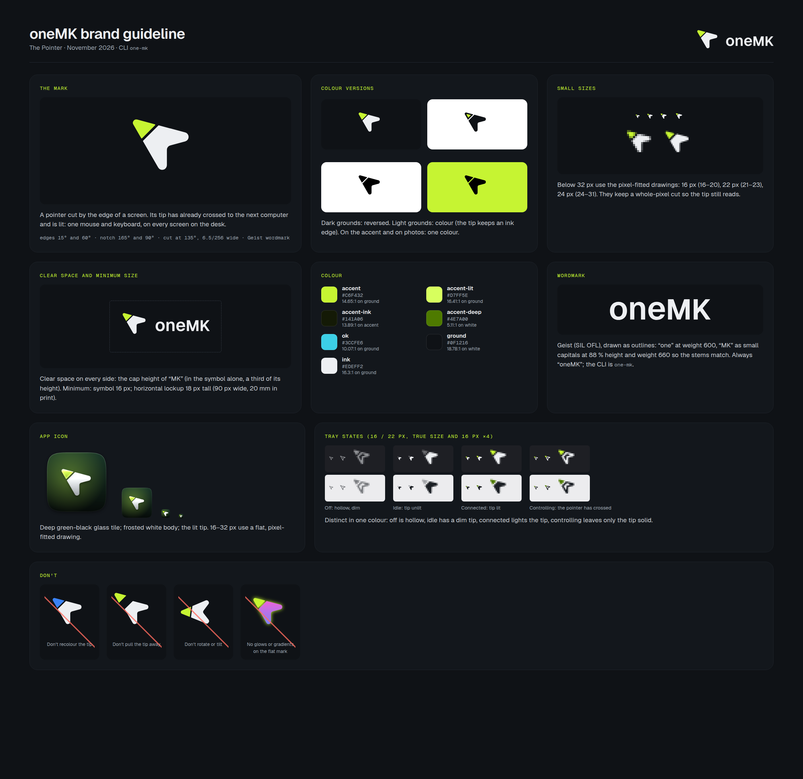
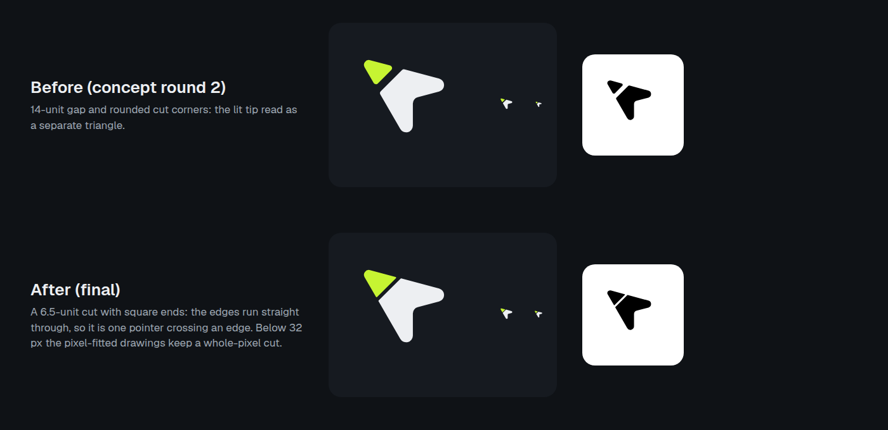
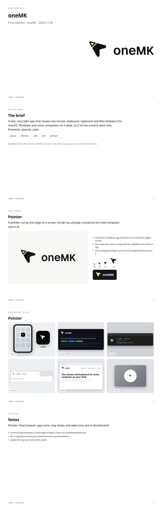

# oneMK brand



The product is **oneMK**: lowercase "one", capital "MK", one word, no dot. The command-line tool stays `one-mk`.

## The idea

**The Pointer.** A pointer cut by the edge of a screen. Its tip has already crossed to the next computer and is
lit. The pointer is what oneMK moves; the cut is the edge it crosses. Everything else (the clipboard, files, the
desk of screens) follows the pointer.

- Precise: exact angles. The long edges run at 15° and 60°, the notch at 165° and 90°, and the cut at 135°.
- Effortless and calm: one quiet shape, flat in the logo and glass in the app icon.
- Fast: the tip is already on the other side.
- Ownable: the category is all blue monitors and arrows. A tail-less pointer with a lit, cut-off tip in Volt on deep
  green-black belongs to no one else.

### Refined for the final kit



In the concept round, the cut was 14/256 wide with rounded ends, so the lit tip read as a separate triangle. The final
cut is 6.5/256 wide with square ends: the outline runs straight through and it reads as one pointer crossing an
edge. Below 32 px the pixel-fitted drawings keep a whole-pixel cut, so the tip still reads at 16 px.

## Logo

| file | use |
|---|---|
| `logo/onemk-symbol-reversed.svg` | **Primary.** Dark grounds: ink `#EDEFF2`, lit tip Volt `#C6F432` |
| `logo/onemk-symbol-color.svg` | Light grounds: ink `#0F1216`. The tip keeps an ink edge so Volt reads on white |
| `logo/onemk-symbol-black.svg` / `-white.svg` | One colour |
| `logo/onemk-symbol-small16-*.svg`, `-small22-*`, `-small24-*` | Pixel-fitted drawings for 16–31 px |
| `logo/onemk-lockup-horizontal-*.svg` | Symbol and wordmark, the default signature |
| `logo/onemk-lockup-stacked-*.svg` | For square spaces |
| `logo/onemk-wordmark-*.svg` | Wordmark only |
| `logo/png/` | PNGs of all of the above (symbols at 16, 24, 32, 256 and 1024 px; lockups 1600×300 and 900×640; wordmarks 1200×300) |

Every file is filled paths: no live text, no strokes, no masks, no filters.

### Wordmark

"oneMK" is set from **Geist** (SIL Open Font License 1.1) and outlined:
- "one" is at weight 600.
- "MK" is drawn as small capitals at 88 % of the cap height and weight 660, so their stems match the lowercase and
  the capitals don't shout.
- The e→M space is tightened optically, and tracking is −1.2 %.

### Small sizes

Never scale the master below 32 px; use the drawing for the physical pixel size:

| physical px | drawing |
|---|---|
| 16–20 | `small16` |
| 21–23 | `small22` |
| 24–31 | `small24` |
| 32 and up | the master |

### Clear space and minimum size

- **Clear space:** the cap height of "MK" on every side of a lockup. Around the symbol alone, a third of its height.
- **Minimum:**
  - Symbol: 16 px, using the 16 px drawing.
  - Horizontal lockup: 18 px tall, 90 px wide; 20 mm wide in print.
  - Wordmark: 12 px cap height.

## Colour

The brand palette, with the UI tokens proposed for the window. These are not yet in `crates/app/src/style.rs`:

| token | value | use | contrast |
|---|---|---|---|
| **accent** (Volt) | `#C6F432` | The lit tip. Switches that are on, the primary button, the focus ring, the pointer on the desk | 14.6:1 on ground, 13.6:1 on glass |
| accent-lit | `#D7FF5E` | Hover / pressed of anything in the accent | 16.4:1 on ground |
| accent-ink | `#141A06` | Text and icons on the accent | 13.9:1 on accent, 15.5:1 on accent-lit |
| accent-deep | `#4E7A00` | The accent as a graphic on white and on light trays | 5.1:1 on white |
| **ok** (connected) | `#3CCFE6` | Connected / ok status. A cyan, so "on" (Volt) and "connected" never look alike | 10.1:1 on ground, 9.4:1 on glass |
| ground | `#0F1216` | Window ground; ink of the mark on light grounds | 18.8:1 on white |
| ink | `#EDEFF2` | Ink of the mark on dark grounds | 16.3:1 on ground |
| tile | `#1D3A2A` → `#060B09` | App-icon tile (deep green-black) | – |

`src-2026/palette.json` has the same values with computed contrast.

Rules:
- Volt is the only accent. Use it for the lit tip, on states and the one primary action. Don't use it for large
  fills, decoration or text on light grounds.
- On light grounds, Volt needs an ink edge (as in the colour mark) or `accent-deep`.
- On Volt, use the black one-colour mark and `accent-ink` text.
- The ok/connected colour is never Volt.

The table below is written from the window's style by `scripts/brand-tokens.py`. It still shows the previous amber
until `style.rs` takes the palette above.

<!-- tokens:start (scripts/brand-tokens.py writes this table) -->
| token | value | contrast |
|---|---|---|
| ground | `#0B0D11` | ink on it 16.9:1 |
| room | `#0B0D11` | ink on it 16.9:1 |
| sidebar | `#0E1015` | 1.0:1 on ground |
| hairline | `rgba(255, 255, 255, 0.059)` | 6% over what is under it |
| side-chosen | `#1A1D24` | 1.2:1 on ground |
| side-chosen-edge | `rgba(255, 255, 255, 0.071)` | 7% over what is under it |
| side-hover | `#15181E` | 1.1:1 on ground |
| elevated-top | `#171A21` | 1.1:1 on ground |
| elevated | `#12151B` | 1.1:1 on ground |
| elevated-edge | `rgba(255, 255, 255, 0.078)` | 8% over what is under it |
| palette-top | `rgba(22, 25, 31, 0.804)` | 80% over what is under it |
| palette | `rgba(17, 19, 25, 0.843)` | 84% over what is under it |
| search-fill | `#13161C` | 1.1:1 on ground |
| shortcut-ink | `#525A66` | 2.8:1 on ground |
| room-tint | `rgba(16, 19, 24, 0.878)` | 88% over what is under it |
| glass-top | `rgba(54, 56, 61, 0.443)` | 44% over what is under it |
| glass | `rgba(31, 33, 38, 0.42)` | 42% over what is under it |
| glass-clear-top | `rgba(79, 83, 86, 0.278)` | 28% over what is under it |
| glass-clear | `rgba(45, 45, 49, 0.243)` | 24% over what is under it |
| glass-solid-top | `#1C2027` | 1.2:1 on ground |
| glass-solid | `#161A20` | ink on it 15.2:1 |
| control-top | `rgba(146, 149, 160, 0.275)` | 27% over what is under it |
| control | `rgba(108, 113, 123, 0.204)` | 20% over what is under it |
| control-solid-top | `#2A2E35` | 1.4:1 on ground |
| control-solid | `#22262C` | 1.3:1 on ground |
| group | `rgba(255, 255, 255, 0.047)` | 5% over what is under it |
| group-edge | `rgba(255, 255, 255, 0.067)` | 7% over what is under it |
| track | `rgba(0, 0, 0, 0.22)` | 22% over what is under it |
| thumb | `rgba(255, 255, 255, 0.188)` | 19% over what is under it |
| control-edge | `rgba(255, 255, 255, 0.078)` | 8% over what is under it |
| glass-hairline | `rgba(255, 255, 255, 0.047)` | 5% over what is under it |
| glass-rim | `rgba(255, 255, 255, 0.102)` | 10% over what is under it |
| glass-edge | `rgba(255, 255, 255, 0.22)` | 22% over what is under it |
| popover | `#1A1E25` | ink on it 14.5:1 |
| on-glass | `rgba(255, 255, 255, 0.071)` | 7% over what is under it |
| on-glass-lit | `rgba(255, 255, 255, 0.118)` | 12% over what is under it |
| panel | `#13171C` | ink on it 15.6:1 |
| raised | `rgba(255, 255, 255, 0.051)` | 5% over what is under it |
| line | `rgba(255, 255, 255, 0.071)` | 7% over what is under it |
| ink | `#EDEFF2` | 16.9:1 on ground |
| ink2 | `#9DA6B1` | 7.9:1 on ground |
| ink3 | `#8F98A4` | 6.7:1 on ground |
| ink-hover | `#C4CAD2` | 11.8:1 on ground |
| **signal** (amber) | `#C6F432` | 15.2:1 on ground; **1.3:1 on white** |
| accent | `#C6F432` | 15.2:1 on ground |
| accent-lit | `#D7FF5E` | 17.0:1 on ground |
| signal-lit | `#D7FF5E` | 17.0:1 on ground |
| signal-ink | `#141A06` | 13.9:1 on signal |
| error | `#FF6B5E` | 7.0:1 on ground |
| warn | `#FFB547` | 11.1:1 on ground |
| lamp | `#FFB547` | 11.1:1 on ground |
| ok | `#3CCFE6` | 10.4:1 on ground |
| button | `rgba(255, 255, 255, 0.086)` | 9% over what is under it |
| button-lit | `rgba(255, 255, 255, 0.133)` | 13% over what is under it |
| pill | `rgba(255, 255, 255, 0.125)` | 13% over what is under it |
| track-off | `#4A525E` | 2.5:1 on ground |
| track-edge | `#707A86` | 4.5:1 on ground |
| key-edge | `#697380` | 4.0:1 on ground |
| off | `#707A86` | 4.5:1 on ground |
<!-- tokens:end -->

Type in the window: **Geist** 400/600 and **Geist Mono**, as before (see `crates/app/src/style.rs`).

Tokens: [`tokens.json`](tokens.json) and [`tokens.css`](tokens.css), written from the window's own style
(`crates/app/src/style.rs`) by `python3 scripts/brand-tokens.py`; never edit them by hand.

## Approved backgrounds

- Ground, dark glass and photos with dark areas: the reversed mark.
- White and paper: the colour mark.
- Volt: black one colour only.
- Busy photos and gradients: white or black one colour.

## Misuse

Don't:
- recolour the tip, or colour the body;
- pull the tip away from the body, or close the cut;
- rotate, tilt, stretch or mirror the mark;
- add glows, shadows or gradients to the flat mark (glass belongs to the app icon only);
- set the name in another way ("OneMK", "one-mk", "one·mk"), except the CLI command `one-mk`.

Examples are on the guideline sheet; the art is in `guideline/misuse/`.

## App icons

| platform | files |
|---|---|
| macOS | `app-icon/macos/onemk.icns`; `onemk.iconset/` (16–512 pt, @1x and @2x); `png/onemk-64.png`, `png/onemk-1024.png` |
| Windows | `app-icon/windows-linux/onemk.ico` (16, 20, 24, 32, 40, 48, 64, 256); `ico-png/` |
| Linux | `app-icon/windows-linux/hicolor/<size>/apps/one-mk.png` (16–512); `hicolor/scalable/apps/one-mk.svg` |
| Web | `web/favicon.ico`, `favicon.svg`, `favicon-16/32/48.png`, `apple-touch-icon.png`, `icon-192/512.png`, `maskable-512.png`, `site.webmanifest`, `head-snippet.html` |

The icon is a deep green-black tile (`#1D3A2A` → `#060B09`) with a soft Volt light behind the tip, a frosted white
glass body and a lit Volt glass tip. macOS uses the 824/1024 rounded-square grid; Windows, Linux and the web use a
fuller rounded square.

Which drawing each size uses:
- 128 px and up: the layered-glass render, made by `src-2026/glass.py`.
- 48–64 px: `onemk-appicon-mid.svg`.
- 16–32 px: `onemk-appicon-tiny.svg`, a flat drawing using the 16 px pointer, so it stays crisp.

`onemk-appicon-master.svg` is the same icon as a plain SVG (gradients, no filters), used for the scalable Linux icon.

## Tray icons

Four states, matching `IconState` in `crates/tray/src/icon.rs`, told apart by shape even in one colour:

| state | drawing |
|---|---|
| **Off** | hollow outline, dimmed |
| **Idle** | the pointer, tip unlit (35 %) |
| **Connected** | tip lit (Volt; `accent-deep` on light trays) |
| **Controlling** | body hollow, tip lit: the pointer is over there |

Sizes are 16, 22, 24 and 32 px at @1x and @2x:
- `tray/dark/`: dark trays.
- `tray/light/`: light trays.
- `tray/template/`: macOS template images for Off and Idle (black + alpha).

`tray/svg/` has the sources. Geometry for drawing them in Rust, and the colour test the tray tests need, is in
[`tray-geometry.md`](tray-geometry.md).

## Presentation



`guideline/board.html` and `guideline/board/slide-0*.png` are made by the logo-design skill's `presentation_board.py`
from `guideline/board-spec.json`.

## Rebuilding

Everything is generated from `src-2026/`:
- `mark.py`: the pointer geometry (master and pixel-fitted drawings, outlines, insets) and the palette.
- `kit.py`: writes every logo, PNG, app icon, `.icns`/`.ico`, tray and web file.
- `glass.py`: the layered-glass app-icon render.
- `guide.py`: the guideline sheet, misuse art, before/after, `palette.json` and the presentation board.
- `geomdoc.py`: writes `tray-geometry.md`.
- `make_outlines.py`: regenerates `wordmark-outlines.json` from Geist.

```sh
python3 docs/brand/src-2026/kit.py          # logo png app tray web
python3 docs/brand/src-2026/guide.py
python3 docs/brand/src-2026/geomdoc.py
```

It needs:
- Python 3 with **numpy** and **Pillow**.
- The logo-design skill's `render_png.py` and `presentation_board.py`, which use headless Chrome.
- `fontTools` + `brotli` only to regenerate the wordmark outlines.

`.icns` and `.ico` are packed by `kit.py`, so `iconutil` is not needed. `src/` is the previous mark (one·mk
"Crossing"); don't run it, it would overwrite these files. Concept rounds are in `concepts/`.
