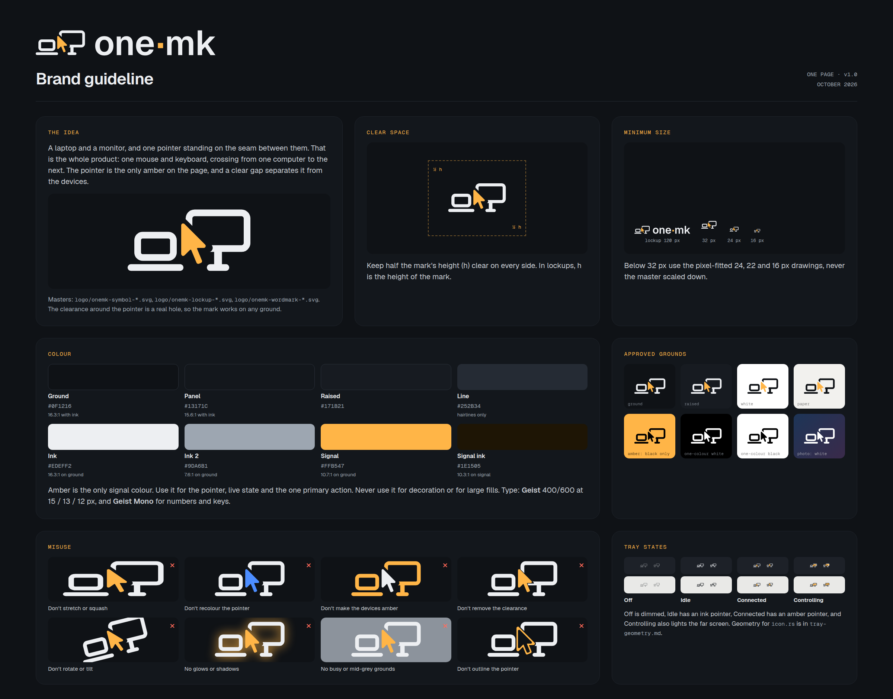
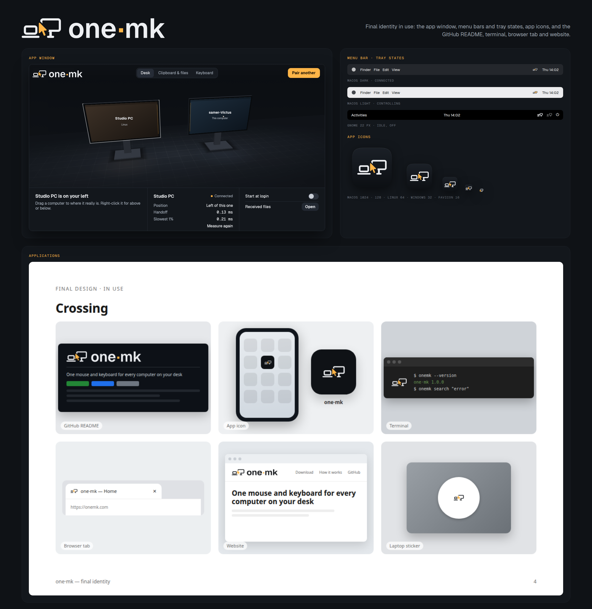

# one·mk brand



## The idea

A laptop and a monitor, with one pointer standing on the seam between them. That is the product: one mouse and
keyboard, crossing from one computer to the next. The pointer is the classic arrow and the only amber in the mark.
A clear gap separates it from the devices. The gap is a real hole in the artwork, so the mark works on any
background, in one colour and reversed.

Name: **one·mk**, with a middle dot. The CLI is `one-mk`.

## Logo

| file | use |
|---|---|
| `logo/onemk-symbol-reversed.svg` | **Primary.** Mark on dark grounds (ink `#EDEFF2` + amber) |
| `logo/onemk-symbol-color.svg` | Mark on light grounds (ink `#0F1216` + amber) |
| `logo/onemk-symbol-black.svg` / `-white.svg` | One colour |
| `logo/onemk-symbol-small16-*.svg`, `-small22-*`, `-small24-*` | Pixel-fitted drawings for 16–31 px |
| `logo/onemk-lockup-horizontal-*.svg` | Mark + wordmark, the default signature |
| `logo/onemk-lockup-stacked-*.svg` | For square spaces |
| `logo/onemk-wordmark-*.svg` | Wordmark only |
| `logo/png/` | PNGs of all of the above |

The wordmark is set from the real **Geist SemiBold** outlines (OFL) and tracked slightly tight. The interpunct is a
deliberate amber square, centred on the x-height. Every file is filled paths: no live text, no strokes, no masks.

### Small sizes

Below 32 px, use the pixel-fitted drawings, never the master scaled down:

- **16 px:** keeps **both computers and the pointer**. It uses 1 px strokes on whole pixels, a 1 px seam with
  the pointer's tip in it, and a smaller pointer, so the laptop's screen and both stands survive. It was tested
  at true size on dark and light bars and stays readable as "laptop, pointer, monitor".
- **22 px** (GNOME/AppIndicator): 2 px monitor frame, whole-pixel edges.
- **24 px:** 1.5 px strokes.
- **32 px and up:** the master.

Inside an app-icon *tile* at 16–20 px there is too little room for two computers. There, and only there, the
icon falls back to **one monitor + pointer**.

### Clear space and minimum size

- Clear space: **half the mark's height** on every side. In lockups, use the mark's height.
- Minimum: horizontal lockup **120 px** wide (25 mm in print); wordmark **64 px** (14 mm); symbol **16 px**
  (using the 16 px drawing).

## Colour

| token | hex | contrast |
|---|---|---|
| ground | `#0F1216` | ink on it 16.3:1 |
| panel | `#13171C` | ink on it 15.6:1 |
| raised | `#171B21` | |
| line | `#252B34` | 1.32:1, hairlines only |
| ink | `#EDEFF2` | 16.3:1 on ground |
| ink2 | `#9DA6B1` | 7.6:1 on ground (AA for all text) |
| **signal** (amber) | `#FFB547` | 10.7:1 on ground; **1.8:1 on white** |
| signal-ink | `#1E1505` | 10.3:1 on signal |

Amber is the only signal colour. Use it for the pointer, live state and the one primary action. Do not use it for
decoration, large fills or text on light backgrounds. On amber, use the black one-colour mark.

Type: **Geist** 400/600 at 15 / 13 / 12 px; **Geist Mono** for numbers, timings and keys.
Tokens: [`tokens.json`](tokens.json) and [`tokens.css`](tokens.css).

## Approved backgrounds

- Ground and raised: the reversed mark.
- White and paper: the colour mark.
- Amber: black only.
- Photos and gradients: white only.
- Any background: black or white one-colour.

## Misuse

Don't:
- stretch, rotate or tilt the mark;
- recolour the pointer, or make the devices amber;
- remove the clearance around the pointer;
- add glows or shadows;
- place the mark on busy or mid-grey grounds;
- outline the pointer.

All of these are shown in the guideline sheet above.

## App icons

| platform | files |
|---|---|
| macOS | `app-icon/macos/onemk.icns`; `onemk.iconset/` (16–512 pt, @1x and @2x); master `onemk-appicon-master.svg` (1024, Big Sur squircle grid) |
| Windows | `app-icon/windows-linux/onemk.ico` (16, 20, 24, 32, 40, 48, 64, 256) |
| Linux | `app-icon/windows-linux/hicolor/<size>/apps/one-mk.png` (16–512); `hicolor/scalable/apps/one-mk.svg` |
| Web | `web/favicon.ico`, `favicon.svg`, `favicon-16/32/48.png`, `apple-touch-icon.png`, `icon-192/512.png`, `maskable-512.png`, `site.webmanifest`, `head-snippet.html` |

The tile is dark (`#1B2027` → `#0D1014`, a subtle top light) with a faint rim highlight. The `-tiny`, `-mid`
and `-master` SVGs are the drawings used for ≤20 px, ≤48 px and larger sizes.

## Tray icons

There are four states, matching `IconState` in `crates/tray/src/icon.rs`:
- **Off:** dimmed, no pointer.
- **Idle:** ink pointer.
- **Connected:** amber pointer.
- **Controlling:** amber pointer, and the far screen lit amber.

Sizes are 16, 22, 24 and 32 px at @1x and @2x:
- `tray/dark/`: dark trays
- `tray/light/`: light trays; the pointer gets a dark edge
- `tray/template/`: macOS template images for Off and Idle (black + alpha)

The geometry for drawing these procedurally in Rust is in [`tray-geometry.md`](tray-geometry.md).

## Presentation



- `guideline/onemk-presentation-board.png`: app window, menu bars, app icons, README, terminal, browser tab,
  website.
- `guideline/board/slide-0*.png`: the same as slides.

## Rebuilding

Everything is generated from `src/`:
- `mark.py`: the geometry of the master and the pixel-fitted drawings
- `geom.py`: real knockouts by polygon difference
- `wordmark.py`: reads Geist with a tiny TrueType reader
- `kit.py`: writes every file
- `guide.py`: renders the guideline sheet

```sh
python3 docs/brand/src/kit.py logo app tray png web
python3 docs/brand/src/guide.py
```

It needs Python 3, Pillow (only to read PNG sizes) and the logo-design skill's `render_png.py`, which uses
headless Chrome. The `.icns` and `.ico` files are packed by `kit.py` itself, so `iconutil` is not needed.

Earlier concept rounds are in `concepts/`.
