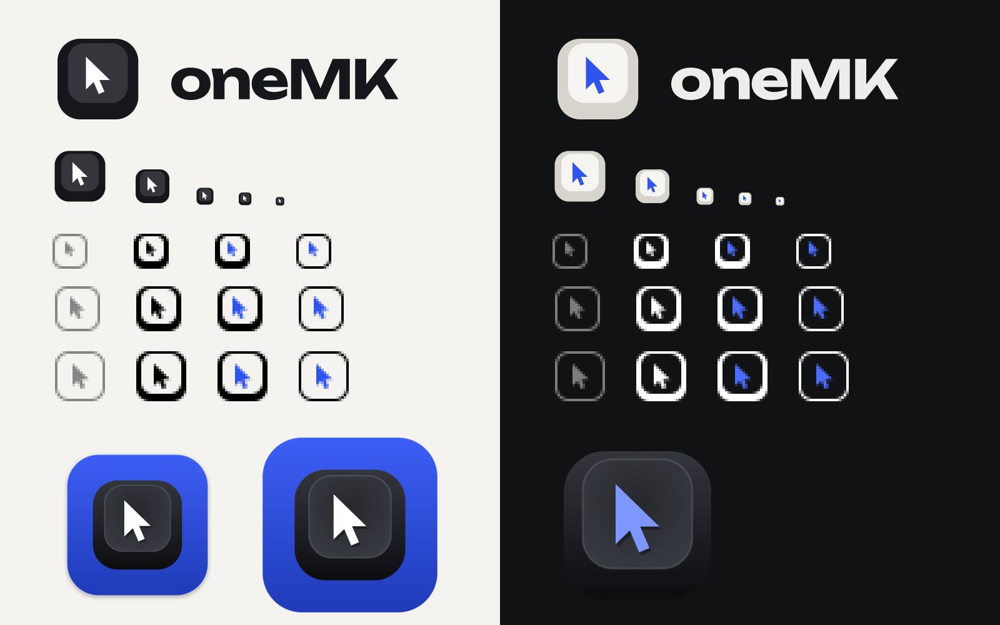

# oneMK brand



The product is **oneMK**: lowercase "one", capital "MK", one word, no dot. The command-line tool stays `one-mk`.

## The idea

**Sculpted keycap.** A keycap with the pointer on its top: one keyboard and one mouse, shared by every computer. The
key is the keyboard, the pointer is the mouse, and the pointer sits where your fingers are.

Construction, on a 64 grid:
- the key is 54 × 54, radius 15, at (5, 5);
- its top is 40 × 40, radius 11, at (12, 8);
- the pointer is the path `M24 17L24 39L29.2 34L32.6 42L36.4 40.4L33 32.6L40 32.6Z`.

Two renderings of the same drawing:
- **Sculpted** (gradients and a pointer shadow): the app icon and anything 64 px or larger.
- **Flat**: the in-app logo and anything under 64 px.

## Files

All art is SVG in [`logo/`](logo/), made of filled shapes only (the wordmark is outlined: no live text, no fonts needed).
These are the source of truth; everything else is built from them.

| file | use |
|---|---|
| `logo/onemk-appicon.svg` | The app icon: the sculpted key on a cobalt tile (`#3C5EF5` → `#1F3BB8`, top to bottom), radius 230/1024, a 30 % white inner highlight |
| `logo/onemk-symbol-sculpted.svg` | The sculpted key alone, for hero sizes of 64 px and up |
| `logo/onemk-symbol-flat-on-light.svg` | Flat key for light grounds: cap `#16171A`, top `#34363C`, pointer `#FFFFFF` |
| `logo/onemk-symbol-flat-on-dark.svg` | Flat key for dark grounds: cap `#D6D4CD`, top `#F6F5F1`, pointer cobalt `#2F54EB` |
| `logo/onemk-wordmark-on-light.svg`, `-on-dark.svg` | "oneMK" in Unbounded Bold 700, tracking −0.04 em, outlined. Ink `#16171A` / `#EDEDEB` |
| `logo/onemk-lockup-on-light.svg`, `-on-dark.svg` | Flat key and wordmark: the default signature |

The wordmark is for the logo only; the interface itself is set in Inter and JetBrains Mono. In the window the symbol is 24 px
and the wordmark 15 px beside it, 9 px apart.

## Colour

`tokens.json` holds the full colour, type and size tokens of the window (light "Daylight" and dark). The brand's own colours:

| token | value | use |
|---|---|---|
| paper | `#F6F5F1` | the key's top on dark grounds |
| ink | `#16171A` | text and the key on light grounds |
| cobalt | `#2F54EB` | the accent: primary action, a lit pointer, selection, focus, progress, a changed key |
| cobalt-light | `#7E97FF` | the accent's lit rendering on dark |
| icon tile | `#3C5EF5` → `#1F3BB8` | the app icon's background |

Cobalt is the only accent. It is never decoration, and status is always colour and shape together.

## App icons

Built from `logo/onemk-appicon.svg` by [`scripts/make-icons.py`](../../scripts/make-icons.py):

| platform | files |
|---|---|
| macOS | `app-icon/macos/onemk.icns`; `onemk.iconset/` (16 to 512 pt, @1x and @2x); `png/onemk-64.png`, `png/onemk-1024.png`. The tile is 824 of the 1024 grid with a soft shadow, as macOS expects |
| Windows | `app-icon/windows-linux/onemk.ico` (16, 20, 24, 32, 40, 48, 64, 256) |
| Linux | `app-icon/windows-linux/hicolor/<size>/apps/one-mk.png` (16, 22, 24, 32, 48, 64, 128, 256, 512) and `hicolor/scalable/apps/one-mk.svg` |
| the window | `crates/app/assets/icon-256.rgba` (title bar, task switcher) |

The tile is full-bleed on Windows and Linux, and sits on the macOS grid on macOS. The small sizes are the same drawing
reduced with a box filter; the key and the pointer both stay legible at 16 px.

## Tray icons

Four states, matching `IconState` in `crates/tray/src/icon.rs`, told apart by shape even without colour:

| state | drawing |
|---|---|
| **Off** | hollow key outline, dimmed to 45 % |
| **Idle** | solid key, the pointer in the open top |
| **Connected** | solid key, the pointer lit cobalt |
| **Controlling** | hollow key outline, the pointer lit cobalt |

Each is drawn on whole pixels at 16, 22 and 24 px and again at 2x (32, 44 and 48 px): the layout numbers are in
`TRAY_GEOMETRY` in `scripts/make-icons.py`, because reducing the 64 grid would put edges between pixels.
- `tray/dark/`: white ink, cobalt `#4D6DFF`, for dark bars.
- `tray/light/`: black ink, cobalt `#2F54EB`, for light bars.
- `tray/template/`: black plus alpha, for the macOS menu bar to recolour (Off and Idle only; cobalt cannot be a template).

`one-mk-tray` embeds them as raw RGBA (`crates/tray/assets/<bar>-<state>-<px>.rgba`). macOS and Windows pick the bar from the
system's dark or light mode; Linux panels cannot say, so it uses the dark set there.

## Minimum size

The symbol is used down to 16 px. Under 64 px use the flat key, never the sculpted one.

## Misuse

Don't:
- recolour the key or its pointer (the flat key has the two colourways above, nothing else);
- stretch, rotate, tilt or mirror the key; pull the pointer off its top;
- add glows, shadows or gradients to the flat key;
- use the old green-and-black pointer or any lime colour;
- set the name in another way ("OneMK", "one-mk", "one·mk"), except the CLI command `one-mk`.

## Rebuilding

```sh
python3 scripts/make-icons.py          # every icon, the tray icons, the window's embedded files, overview.png
python3 scripts/make-icons.py --check  # fails if a checked-in file is not what the SVGs give now
python3 scripts/dmg/make_background.py # the macOS installer window's artwork (see docs/PACKAGING.md)
```

They need Python 3 and Pillow only: `scripts/brand_render.py` is a small deterministic SVG rasteriser that reads exactly what
the files in `logo/` use, so no rsvg, Inkscape, ImageMagick, Chrome or `iconutil` is needed. `.icns` and `.ico` are
written directly. The same script copies the four flat symbol and wordmark SVGs the window embeds into
`crates/app/assets/brand/`.
